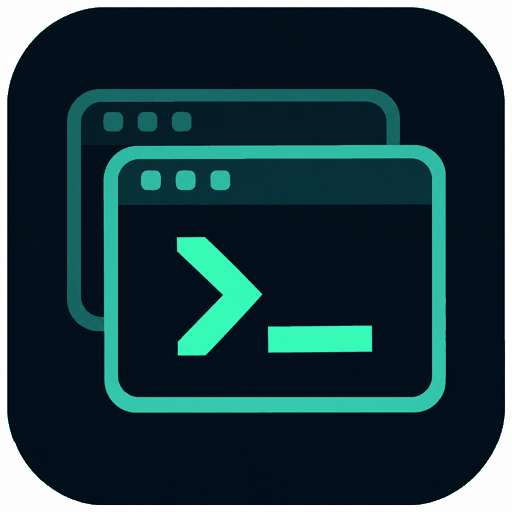

<h1> Zero SSH</h1>

**English** · [简体中文](README.zh-CN.md)

Zero SSH is an SSH client for the **M5Stack Cardputer Zero**. Use the device keyboard to manage multiple hosts, open remote terminals, and switch between active sessions. The web interface lets you manage hosts, import private keys, and use the terminal from a browser on the same local network.

## Installation

Copy the ARM64 Zero SSH Debian package to your Cardputer Zero. Open the CLI on the device, change to the directory containing the package, and run the command below with the actual filename.

```sh
sudo apt install ./zero-ssh.deb
```

After installation, open **Zero SSH** from the app launcher. To install from source, run `bash native/install.sh` on the device as the user who runs the app launcher.

## Using Zero SSH on the device

Select **Add host** at the top of the host list. Enter a name, address, and port on the first page, then the username and password on the second page. Press `Sym+B` to type a period in an IP address. Leave the password blank to enter it when you connect.

| Key | Action |
| --- | --- |
| `Tab` or `F` / `X` | Move through the host list |
| `Enter` | Connect to the selected host or resume its session |
| `E` | Edit the selected host |
| `D` | Disconnect the selected host |
| `S` | Open settings from the host list |
| Press `Esc` | Return to the host list from the terminal or settings |
| Hold `Esc` for 3 seconds on the host list | Exit the app |

When you leave the terminal view, you can resume the session from the host list. To delete a host, open its edit form, select the delete option on the second page, and confirm.

## Managing hosts from a browser

1. Open Zero SSH on your Cardputer Zero and go to the second page of the add or edit host form.
2. In a browser on the same local network, open the web address shown on the device and enter the six-digit access code.
3. Add or edit hosts, or open a terminal. For key-based authentication, select **Private key** and import an OpenSSH or PEM private key file.

The device and the web interface share the same hosts and sessions. The access code changes when the web service restarts.

## Settings

- **Language** supports the system default, Simplified Chinese, and English. The web interface follows the language saved on the device.
- **Terminal theme** includes Dracula, Nord, Solarized Dark, and Gruvbox Dark.
- **Keep services on exit** is off by default. Exiting the app closes the SSH sessions and stops the web service. Enable this option to leave the device interface while keeping browser access and SSH sessions active.

## License

[MIT](LICENSE)
